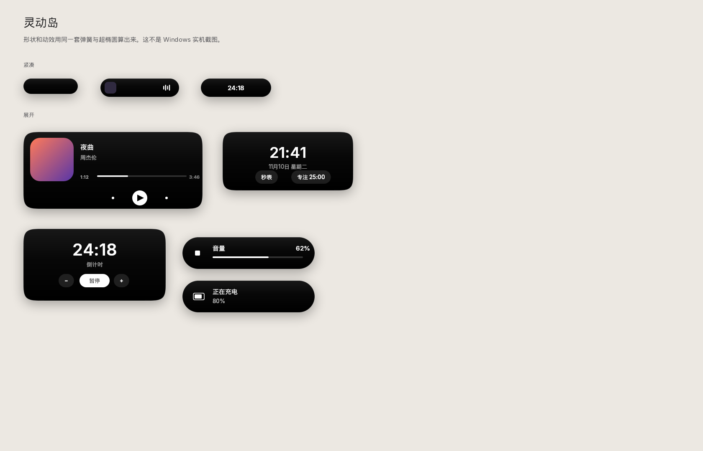
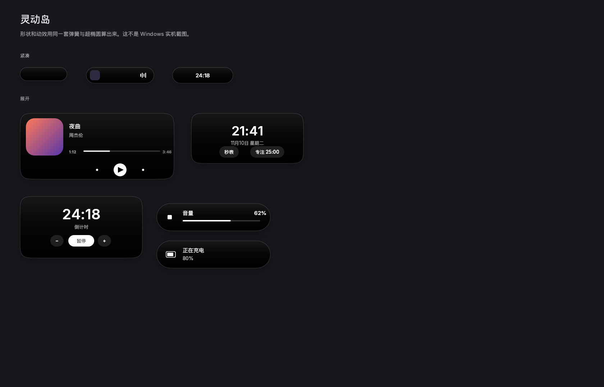
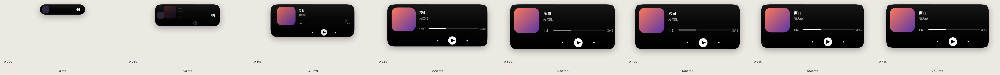
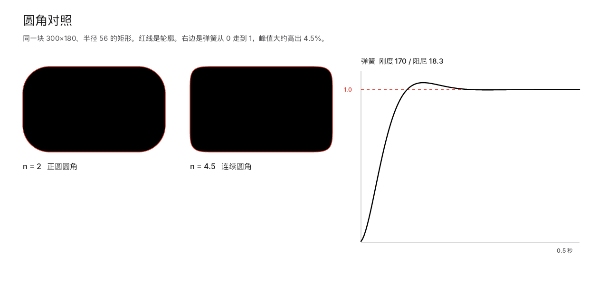

# 灵动岛

一块停在屏幕顶部正中的黑胶囊。有音乐时它显示封面和一条会动的波形；鼠标放上去，它用弹簧撑开，变成播放器。音量、插拔电源、倒计时结束，也会从这里冒出来。

它一直在最前面，但不抢焦点，不出现在任务栏，也不出现在 Alt+Tab 里。点岛外面的桌面，点击会穿过它。

需要 **Windows 10 版本 2004（19041）或 Windows 11**。程序自带运行库，不用另装 .NET。

## 预览

下面这些图是用**同一套超椭圆和弹簧**画出来的，字体是 Inter 和文泉驿。它们不是 Windows 上的实机截图。真正的窗口用 Segoe UI 和微软雅黑，阴影是 WPF 的投影。





从紧凑到展开，采样的是弹簧自己的位置，不是手画的关键帧：





动图在 `docs/previews/motion.gif`。

## 下载和运行

1. 拿到 `DynamicIsland-win-x64.zip`，解压。
2. 双击 `DynamicIsland.exe`。
3. 第一次会慢几秒。单文件程序要把运行库解到临时目录，之后就快了。

压缩包里有一份短说明 `readme.txt`。

### “Windows 已保护你的电脑”

这个 exe **没有代码签名**。SmartScreen 会说发行者未知。点 **更多信息**，再点 **仍要运行**。这是未签名程序的正常提示，不是程序坏了。

## 托盘、开机启动、退出

岛本身没有退出按钮。平时也不接受键盘，开关都在托盘。译文卡片上的「关闭」只清掉这一条译文。

时钟旁边有一个小图标（黑胶囊，带一圈白边，深色和浅色任务栏都能看见）：

- **左键**：岛展开大约 5 秒。鼠标移上去会保持展开，移开后再收回。如果还留着一条译文，左键会打开那条译文，而不是只展开 5 秒。
- **右键**打开菜单：
  - **显示器**：默认主屏。点另一项就换到那块屏，并记住。
  - **开机时启动**：勾上之后，下次登录会自动打开。写的是当前用户的注册表 `HKCU\Software\Microsoft\Windows\CurrentVersion\Run`，名字 `DynamicIsland`，不需要管理员。取消勾选会删掉这一项。已经在运行的程序不会因此退出。登录后会先等 12 秒，再显示岛、再去接音乐和音量，免得跟开机抢资源。自己双击打开不等这 12 秒。
  - **隐身**：收成一颗很小的圆点。音量、电池、通知和翻译邀请仍会短暂冒出来，然后缩回去。再点一次恢复。这个状态会记住。
  - **某个程序聚焦时隐藏**：菜单里会出现当前这块屏上、上一个别人的前台程序。点一下就放进隐身名单，再点移出。名单里的程序只要在岛所在的这块屏上成为前台（包括全屏），岛就收成小点。别的屏幕不算。
  - **隐身名单**：已经加进去的名字，点一下移出。
  - **翻译剪贴板**：立刻翻译剪贴板里的文字。见下面「翻译」。
  - **翻译结果**：再打开最近一条译文。还没有译文时这一项是灰的。
  - **摄像头画中画**：默认关。见下面「摄像头」。
  - **打开秒表**、**开始 25 分钟专注**
  - **发送一条测试通知**
  - **打开日志**
  - **退出**

设置和日志在 `%AppData%\DynamicIsland\`：`settings.json` 和 `log.txt`。计时器会写进设置里，关掉再打开会接着走。如果倒计时是在程序没开的时候走完的，而且刚走完不久，岛会补一句“时间到”。

## 它会做什么

**音乐。** 读的是 Windows 的系统媒体控件（SMTC），也就是键盘媒体键、Spotify、浏览器里正在播的那一条。紧凑时左边是小封面，右边是波形。展开后有封面、歌名、歌手、进度（如果播放器提供了时长）和上一首 / 播放暂停 / 下一首。这些按钮会真的去控制那个会话。没有会话时，岛缩成一颗安静的胶囊，展开是时钟，可以在这里开秒表或 25 分钟专注。

正在播放的音乐会盖住计时器。音乐暂停时，已经打开的计时器会回到紧凑位。

**音量。** 系统音量或静音变化时，岛展开，显示百分比和一条音量条。按住音量键时它会停在最新的数值上，松手大约 1.7 秒后收回。第一次读到的当前音量不会弹通知。

**电池。** 有电池的电脑才会出现。插上电源、拔掉电源会提示。电量往下掉时，只在跌破 20%、10%、5%，以及每跨过 10% 时说一声，避免每掉 1% 都打扰你。台式机没有电池，这项是安静的。

**提示排队。** 你正看着展开的岛时，新的音量或电量提示会先等着。鼠标离开、岛收回之后，如果那条提示还新鲜，再把它放出来。隐身或全屏收起时不排队，提示会马上冒一下再缩回小点。

**全屏时躲开。** 岛只看自己这块屏幕。这块屏上出现盖住整屏的窗口（独占全屏游戏、全屏视频、放映幻灯片这一类）时，岛收成一颗小圆点。全屏结束就回到原来的位置和大小。另一块屏幕上的全屏不动它。音量和电池这类提示在小点期间仍会短暂展开。

**拖动和吸附。** 按住岛拖一下，松手时吸到这块工作区的上、下、左、右中点，或四个角。默认还是上方正中。吸在左中或右中时，它变成竖胶囊：封面在歌名上面，计时的数字上下排，按钮竖着排，提示的图标在文字上面。不是把横着的布局转 90 度硬塞进去。竖着停靠时，封面在自己的方格里水平、垂直居中，按统一比例铺满后从中间裁掉，不会拉扁，也不会偏到左边或右边。吸回上中或下中之后，封面仍在文字左边，格子里用同一条居中裁切。四角和上下中点仍是横的。每块屏幕各自记住吸在哪。摆放用的是该屏的工作区，再减去能查到的任务栏（`Shell_TrayWnd` 和副屏的 `Shell_SecondaryTrayWnd`），所以 StartAllBack 把任务栏放在上边或侧边时，岛不会盖住它。

**翻译。** 没有选中文字就自动翻译这一路。复制之后（Ctrl+C 或任何会改剪贴板的复制），岛上出现原文预览和一颗「翻译」。这时文字还在这台电脑上。点「翻译」，或在托盘点「翻译剪贴板」，才会把这一段发出去。自动判断中文或英文，也可以改成「中→英」或「英→中」。一次最多发送 400 字，超过的只送前面一段，并在岛上说明。超过 2000 字的剪贴板直接忽略。不需要 API 密钥。发出去的地址是 `https://api.mymemory.translated.net`（MyMemory 的公开接口，匿名有每日额度）。岛上的「自动 / 中→英 / 英→中」会记住。剪贴板监听只在本地决定要不要弹出邀请，不会在后台把剪贴板连续送出去。

译文出来以后，鼠标移开不会马上把它收起来。译文可以选中，用 Ctrl+C 或右键「复制」复制，也可以点岛上的「复制」。选字和点复制不会把岛拖走，也不会把它收起。点「关闭」会清掉这条译文。如果已经复制过，再把鼠标移开，这条译文就不再保留。岛收起来的时候文字还在：鼠标放上岛、点一下，或托盘里的「翻译结果」，都会再打开最近一条。全屏或隐身把岛收成小点时也不丢掉译文，退出之后还能再看。

**摄像头。** 托盘里的「摄像头画中画」默认关闭，也不会因为上次开过就在下次启动时自己打开。点开之后岛展开，开始预览，左上角有一颗红点，旁边写着「摄像头」。拖到新的位置、松手吸附、鼠标离开，预览都还在，不会因为窗口动了就把摄像头关掉。画面按摄像头自己的宽高比铺进岛里，多出来的从中间裁掉，横着停和竖着停用同一条规则，不会拉扁或拉高。再点一次关掉、进入隐身或全屏、或者退出程序，都会马上放开摄像头，不会在后台继续占着。没有摄像头，或系统拒绝权限时，岛上会写清楚原因。权限在「设置 → 隐私和安全性 → 摄像头」，需要允许访问，并允许桌面应用使用。

波形不是这首歌的频谱。系统媒体控件不提供音频采样。播放时，四根竖条按设计好的节奏摆动，高度再乘上默认播放设备的峰值；暂停时竖条收回去。

## 命令行

程序已经在跑的时候，再开一次会把参数交给它，不会开出第二个窗口。

```text
DynamicIsland.exe --toast 标题 正文
DynamicIsland.exe --timer stopwatch
DynamicIsland.exe --timer 25
```

不带参数再启动一次，等于让岛展开。

## 想改外观

颜色、尺寸、手感各有一个地方，改完跑测试。

| 想改什么 | 文件 |
| --- | --- |
| 颜色 | `src/DynamicIsland.Core/Island/Palette.cs` |
| 每种状态的宽、高、圆角 | `src/DynamicIsland.Core/Island/IslandMetrics.cs` |
| 弹簧有多快、过冲多大 | `src/DynamicIsland.Core/Motion/MotionTune.cs` |
| 内容什么时候淡入、模糊多少 | `src/DynamicIsland.Core/Motion/Easing.cs` |
| 圆角是正圆还是连续圆角（指数 n） | `IslandMetrics.cs` 里的 `CornerN`，算法在 `Geometry/Squircle.cs` |
| 界面怎么排 | `src/DynamicIsland/Views/` 里的 XAML |

现在的弹簧刚度 170、阻尼 18.3，过冲大约 4% 到 5%，半秒左右落定。紧凑态是正圆胶囊（n = 2，半径等于高度的一半）。展开的音乐卡用 n = 4.5 的连续圆角。变形过程中 n 和宽高走同一套弹簧，所以中途不会突然变成一个小圆角矩形。

`dotnet test` 会检查过冲幅度、胶囊面积、悬停延迟和电量提示的频率。手感改得太夸张，测试会先告诉你。

预览图可以用下面的命令重画（需要能跑 .NET 8 的环境，不需要 Windows）：

```bash
dotnet run --project tools/RenderMock/RenderMock.csproj -c Release -- docs/previews
```

## 自己编译

需要 [.NET 8 SDK](https://dotnet.microsoft.com/download/dotnet/8.0)。

```bash
dotnet test tests/DynamicIsland.Core.Tests/DynamicIsland.Core.Tests.csproj -c Release
./build/publish.sh
```

`publish.sh` 在 Linux、macOS、Windows 上都能打出 **win-x64、自带运行库、单个 exe**。Linux 上要能访问 NuGet，项目里已经打开了 `EnableWindowsTargeting`。

GitHub Actions（`.github/workflows/windows.yml`）会在 `windows-latest` 上打同一个 zip 并上传为构件。打 `v*` 标签时，会把它挂到对应的 GitHub Release 上。

`installer/DynamicIsland.iss` 是 Inno Setup 6 的脚本，**没有在这里编译过**。要装 Inno Setup 之后自己打开编译，并且把 `DynamicIsland.exe` 放在脚本旁边。

## 已知限制

- 只支持 64 位 Windows 10 2004 及以上。更老的 Windows 10 没有这份系统媒体控件的投影。
- 波形是指示动画加系统音量峰值，不是逐首歌的频谱。
- 进度依赖播放器有没有通过 SMTC 报告时长。有的程序不报，岛上就不画进度条，按钮仍然能用。
- 透明窗口在 WPF 里走软件绘制。横着停靠时，岛所在的窗口大约 760×360 设备无关像素；吸在左右两侧时换成大约 420×560，用来放竖胶囊。不是全屏遮罩。
- 岛外面的点击靠 `WM_NCHITTEST` 返回穿透。这套行为没有在真机上点过，如果发现某块区域点不下去，日志在 `%AppData%\DynamicIsland\log.txt`。
- 岛平时不拿键盘焦点，所以没有全局快捷键。复制之后要点岛上的「翻译」，或用托盘里的「翻译剪贴板」。唯一的例外是点在译文上要选字或按 Ctrl+C 的那一会儿：这次点击会让窗口短暂接受键盘，好让只读文本框能选中。窗口仍然是工具窗口，不出现在任务栏和 Alt+Tab，其他点击也不激活它。指针离开后，焦点还给原来的窗口。
- 没有做「选中一段文字就弹出翻译」。Windows 没有一个便宜的全局事件表示「用户刚选中了文字」。要做的话就得挂鼠标钩子，或者不停地问 UI Automation，那会变成后台监听。这次只做复制后的邀请，和托盘里的明确动作。
- 翻译要能上网，而且只在你点了翻译之后才连 `api.mymemory.translated.net`。匿名额度用完、断网、或服务不回答时，岛上会说没译成，不会自己重试。译文经过对方的服务器。
- 摄像头只用系统自带的采集接口。预览大约一秒十几帧。拖动和换停靠位置不会停。关掉、隐身、全屏或退出才停。权限被拒绝或没有设备时不会反复去开。画面是居中裁切，不是把传感器的方向信息单独转正；如果驱动交出来的缓冲本身是侧着的，岛上也会是侧着的。
- 开机启动是登录时运行，不是服务，也不会在登录界面之前出现。带 `--delayed-start` 时先等 12 秒。已经勾过开机启动的旧记录，会在这次运行之后改成带这个参数，下一次登录才开始等待。
- 收起或缩成小点并且弹簧已经停住时，不再做内容模糊，也不再订 60 帧的渲染回调。紧凑态的波形改在大约 80 毫秒一次的计时器上走。展开，以及展开/收回还在变形的那一段，仍走原来的弹簧和模糊。停稳后的投影还在，避免胶囊看起来贴在屏幕上。
- 单文件第一次启动要解压本机库，杀毒软件可能因此多看一眼。
- 未签名，SmartScreen 会拦截一次。
- 计时器存在本机设置里。卸载或删掉 exe 不会自动清 `%AppData%\DynamicIsland`。

## 这台机器上验证过什么

开发和打包是在 Linux 上完成的，**没有 Windows 桌面，WPF 窗口没有跑起来**。

验证过的：

- 弹簧、超椭圆、悬停/通知状态机、电量与音量的判断、计时器、时间格式，加上吸附边、工作区避让、全屏/隐身规则、启动延迟、翻译是否允许发网、摄像头默认关闭、拖动时不释放采集、摄像头的居中裁切，以及这次的译文保留/指针离开/选字不拖动、竖排封面格子的摆放和封面居中裁切，共 79 个测试，在 Linux 上通过。
- 工程能交叉编译成 `net8.0-windows` 的 WPF 程序（含摄像头、翻译和封面裁切的那一层）。WPF 窗口本身没有跑起来。
- 上面的预览图仍是原来那套几何和弹簧在 Linux 上渲染的，不包含竖胶囊、小点和摄像头。

没有在真机上验证的：

- 窗口是否真的不抢焦点、不进任务栏和 Alt+Tab。
- 拖动、吸附、竖排版、躲开任务栏、全屏收成小点、多屏只看当前这块。
- 竖着停靠时封面是否真的在格子正中，以及吸回上中、下中之后有没有偏。裁切用的比例在测试里对过，窗口里没有画出来看过。
- 弹簧和模糊在 WPF 透明窗口里的实际帧率，以及收起后 CPU 有没有下来。
- SMTC 读歌、封面、上一首/下一首/播放。
- 音量回调、电池插拔、托盘菜单、开机启动注册表、12 秒延迟、多屏和 DPI。
- 复制后的邀请、点「翻译」之后 MyMemory 是否返回译文。
- 译文会不会在鼠标离开时立刻收起，收起后悬停、点击或托盘「翻译结果」能不能再打开，选字、Ctrl+C、右键「复制」和「复制」按钮会不会把岛拖走或收起。这些规则在状态机测试里对过，真窗口没有点过。
- 摄像头权限、预览、红点和收起时是否真的放开设备。
- Inno Setup 安装包。GitHub Actions 的 `windows-latest` 工作流仍负责测试和打出 `DynamicIsland-win-x64.zip`。这次改动没有改工作流文件。
