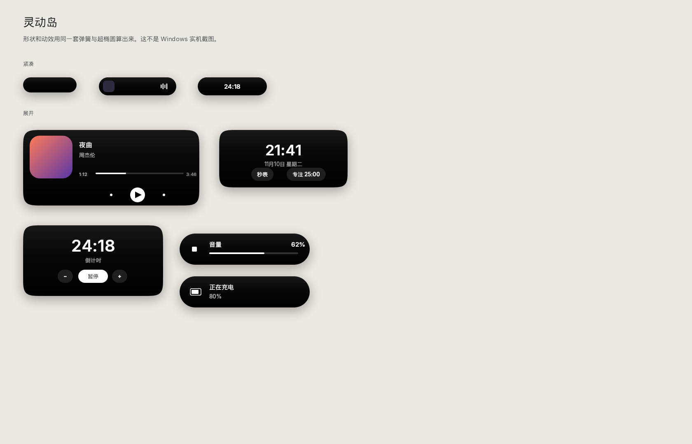
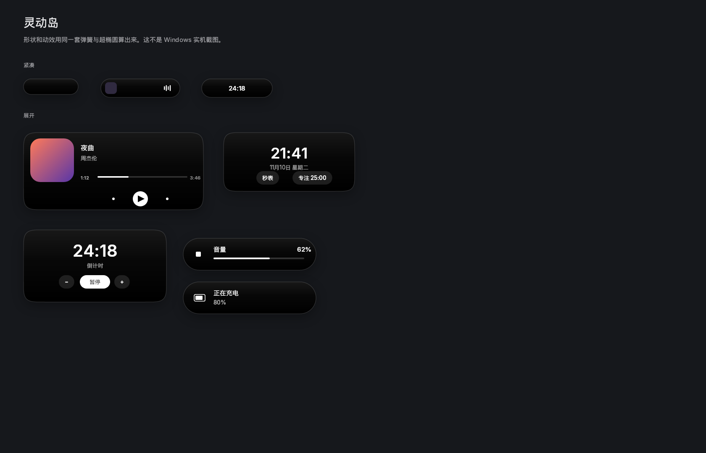
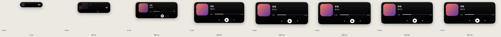
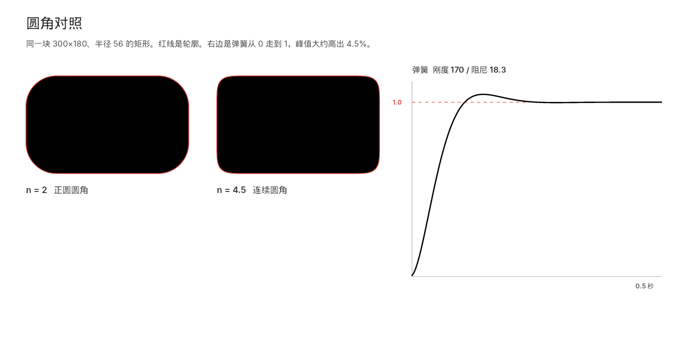

# 灵动岛

一块停在屏幕顶部正中的黑胶囊。有音乐时它显示封面和一条会动的波形；鼠标放上去，它用弹簧撑开，变成播放器。音量、插拔电源、倒计时结束，也会从这里冒出来。

它一直在最前面，但不抢焦点，不出现在任务栏，也不出现在 Alt+Tab 里。点岛外面的桌面，点击会穿过它。

需要 **Windows 10 版本 2004（19041）或 Windows 11**。程序自带运行库，不用另装 .NET。

## 预览

下面这些图是用**同一套超椭圆和弹簧**画出来的，字体是 Inter 和文泉驿。它们不是 Windows 上的实机截图。真正的窗口用 Segoe UI 和微软雅黑，阴影是 WPF 的投影。





从紧凑到展开，采样的是弹簧自己的位置，不是手画的关键帧：





动图在 `docs/previews/motion.gif`。

## 下载和运行

1. 拿到 `DynamicIsland-win-x64.zip`，解压到一个文件夹。
2. 双击 `DynamicIsland.exe`。请让它和旁边的 `runtimes` 文件夹留在一起，不要只拷走 exe。
3. 第一次会慢几秒。单文件程序要把运行库解到临时目录，之后就快了。

压缩包里有一份短说明 `readme.txt`。

### “Windows 已保护你的电脑”

这个 exe **没有代码签名**。SmartScreen 会说发行者未知。点 **更多信息**，再点 **仍要运行**。这是未签名程序的正常提示，不是程序坏了。

## 托盘、开机启动、退出

岛本身没有退出按钮。平时也不接受键盘，开关都在托盘。译文卡片上的「关闭」只清掉这一条译文。

时钟旁边有一个小图标（黑胶囊，带一圈白边，深色和浅色任务栏都能看见）：

- **左键**：岛展开大约 5 秒。鼠标移上去会保持展开，移开后再收回。如果还留着一条译文，左键会打开那条译文，而不是只展开 5 秒。
- **右键**打开菜单：
  - **显示器**：默认主屏。点另一项就换到那块屏，并记住。
  - **开机时启动**：勾上之后，下次登录会自动打开。写的是当前用户的注册表 `HKCU\Software\Microsoft\Windows\CurrentVersion\Run`，名字 `DynamicIsland`，不需要管理员。取消勾选会删掉这一项。已经在运行的程序不会因此退出。登录后会先等 12 秒，再显示岛、再去接音乐和音量，免得跟开机抢资源。自己双击打开不等这 12 秒。
  - **隐身**：收成一颗很小的圆点。音量、电池、通知和翻译邀请仍会短暂冒出来，然后缩回去。再点一次恢复。这个状态会记住。
  - **某个程序聚焦时隐藏**：菜单里会出现当前这块屏上、上一个别人的前台程序。点一下就放进隐身名单，再点移出。名单里的程序只要在岛所在的这块屏上成为前台（包括全屏），岛就收成小点。别的屏幕不算。
  - **隐身名单**：已经加进去的名字，点一下移出。
  - **翻译剪贴板**：立刻翻译剪贴板里的文字。见下面「翻译」。
  - **翻译结果**：再打开最近一条译文。还没有译文时这一项是灰的。
  - **摄像头画中画**：默认关。见下面「摄像头」。
  - **打开秒表**、**开始 25 分钟专注**
  - **在岛上显示通知中心**：默认不勾。见下面「通知中心」。勾上才会向系统请求读取通知的权限。
  - **发送一条测试通知**
  - **打开日志**
  - **退出**

设置和日志在 `%AppData%\DynamicIsland\`：`settings.json` 和 `log.txt`。计时器会写进设置里，关掉再打开会接着走。如果倒计时是在程序没开的时候走完的，而且刚走完不久，岛会补一句“时间到”。

## 它会做什么

**音乐。** 读的是 Windows 的系统媒体控件（SMTC）。有好几条会话时，优先显示正在播放的那条；同时在播的，显示最晚开始播的。都停着，就回到系统当前的那条。展开之后，封面上有左右小箭头和 `1/3` 这样的计数，滚轮也能换。上一首、播放和下一首只作用于眼前这一条。会话多一条或少一条时，岛的大小不变，封面格子也不挪。没有会话时，岛缩成一颗安静的胶囊，展开是时钟，可以在这里开秒表或 25 分钟专注。

正在播放的音乐会盖住计时器。音乐暂停时，已经打开的计时器会回到紧凑位。

**音量。** 系统音量或静音变化时，岛展开，显示百分比和一条音量条。按住音量键时它会停在最新的数值上，松手大约 1.7 秒后收回。第一次读到的当前音量不会弹通知。

**电池。** 有电池的电脑才会出现。插上电源、拔掉电源会提示。电量往下掉时，只在跌破 20%、10%、5%，以及每跨过 10% 时说一声，避免每掉 1% 都打扰你。台式机没有电池，这项是安静的。

**通知中心。** 默认关闭。托盘里勾上「在岛上显示通知中心」之后，岛才会向系统请求权限。允许之后，已经进入 **Windows 通知中心** 的新通知会在岛上短暂出现：来源应用、标题、一句摘要。点一下会尽量打开对应的应用。隐身，或者岛所在的这块屏幕正在全屏时，和音量、电池一样：先冒出来，过一会儿再缩回小点。正看着一条译文时，通知会先盖住它，几秒后再回到那条译文。摄像头开着的时候也一样，通知结束回到预览，不会因此关掉摄像头。

它只使用系统的通知监听（`UserNotificationListener`）。不会去挂钩、注入，也不会读取微信、QQ 或其他软件自己的窗口和进程。这些软件只有在你打开了它们的 Windows 通知，并且这条消息真的进了通知中心时，才会出现在岛上。打开这个功能时，通知中心里已经堆着的旧消息不会逐条再弹一遍。

通知的标题和正文不会写进 `%AppData%\DynamicIsland\log.txt`，也不会上传到网络。日志里只有 `notification-center access allowed`、`notification-center arrived` 这种状态。

### 第一次要做的两件事

勾选托盘菜单时，岛上会先说明这两件事，然后向系统请求权限。

**1. 允许本程序读取通知。**

Windows 11：

1. 打开「设置」。
2. 进入「隐私和安全性」。
3. 点「通知」。
4. 找到「通知访问」，或允许应用访问你的通知的那一栏。
5. 打开总开关，再把「灵动岛」或 DynamicIsland 打开。

如果系统弹出「是否允许读取通知」，选允许。以前拒绝过的话，系统不会再问，只能按上面的步骤自己打开。勾选菜单时如果被拒绝，程序会尝试打开这个设置页。

Windows 10 的路径是「设置 → 隐私 → 通知」，同样是允许本程序访问通知。

**2. 让微信、QQ 或其他软件把消息送进通知中心。**

只给本程序开权限还不够。软件自己也要把消息交给 Windows。

微信（Windows 客户端）：

1. 打开微信。
2. 点左下角菜单，或头像旁边的设置。
3. 进入「设置」→「通知」。
4. 打开新消息通知，并打开系统通知或横幅通知。名字以你安装的微信版本为准。只在微信自己的小窗里弹、没有进 Windows 通知中心的消息，岛上看不到。
5. 再打开 Windows「设置 → 系统 → 通知」，确认微信在列表里是允许的。

QQ：

1. 打开 QQ，进入「设置」→「消息通知」或「通知」。
2. 打开新消息的系统通知，允许显示横幅。
3. 打开 Windows「设置 → 系统 → 通知」，确认 QQ 没有被关掉。

其他软件也是这两处：软件自己的通知设置，以及 Windows「设置 → 系统 → 通知」里这个软件的开关。两边都开，消息进了通知中心，岛上才会短暂显示来源、标题和摘要。

**提示排队。** 你正看着展开的音乐、计时或时钟时，新的音量、电量或通知会先等着。鼠标离开、岛收回之后，如果那条提示还新鲜，再把它放出来。隐身或全屏收起时不排队，提示会马上冒一下再缩回小点。

**全屏时躲开。** 岛只看自己这块屏幕。盖住这块屏整块区域的窗口会让它收成小圆点，包括浏览器里的网页全屏、独占的全屏游戏，以及 Kazumi 这种没有标题栏、铺满屏幕的播放器（哪怕底边还差一截任务栏）。普通的最大化窗口不算。另一块屏幕上的全屏不动它。全屏结束就回到原来的位置和大小。音量、电池和通知在小点期间仍会短暂展开。

**拖动和吸附。** 按住岛拖一下，松手时吸到这块工作区的上、下、左、右中点，或四个角。默认还是上方正中。吸在左中或右中时，它变成竖胶囊：封面在歌名上面，计时的数字上下排，按钮竖着排，提示的图标在文字上面。不是把横着的布局转 90 度硬塞进去。竖着停靠时，封面在自己的方格里水平、垂直居中，按统一比例铺满后从中间裁掉，不会拉扁，也不会偏到左边或右边。吸回上中或下中之后，封面仍在文字左边，格子里用同一条居中裁切。四角和上下中点仍是横的。每块屏幕各自记住吸在哪。摆放用的是该屏的工作区，再减去能查到的任务栏（`Shell_TrayWnd` 和副屏的 `Shell_SecondaryTrayWnd`），所以 StartAllBack 把任务栏放在上边或侧边时，岛不会盖住它。

**翻译。** 没有选中文字就自动翻译这一路。复制之后（Ctrl+C 或任何会改剪贴板的复制），岛上出现原文预览和一颗「翻译」。这时文字还在这台电脑上。点「翻译」，或在托盘点「翻译剪贴板」，才会把这一段发出去。自动判断中文或英文，也可以改成「中→英」或「英→中」。一次最多发送 400 字，超过的只送前面一段，并在岛上说明。超过 2000 字的剪贴板直接忽略。不需要 API 密钥。发出去的地址是 `https://api.mymemory.translated.net`（MyMemory 的公开接口，匿名有每日额度）。岛上的「自动 / 中→英 / 英→中」会记住。剪贴板监听只在本地决定要不要弹出邀请，不会在后台把剪贴板连续送出去。

译文出来以后，鼠标移开不会马上把它收起来。译文可以选中，用 Ctrl+C 或右键「复制」复制，也可以点岛上的「复制」。选字和点复制不会把岛拖走，也不会把它收起。点「关闭」会清掉这条译文。如果已经复制过，再把鼠标移开，这条译文就不再保留。岛收起来的时候文字还在：鼠标放上岛、点一下，或托盘里的「翻译结果」，都会再打开最近一条。全屏或隐身把岛收成小点时也不丢掉译文，退出之后还能再看。

**实时翻译。** 默认关闭，也不会记住上次有没有开。在展开的时钟上点「翻译」，或在设置里打开「实时翻译」，岛会捕获系统正在播放的声音（不是麦克风），把外语识别成文字并译成简体中文。说话过程中，识别文字会像会议记录一样持续出现在当前这一句上，并可能随识别修正前面的词；不必等这句说完，出字的同时就会去翻译，译文到达后替换成中文，后面又认出新词时会再更新译文。已经是中文的句子会原样显示，并标「已是中文」。本次打开会记住大约 40 句字幕，旧的在上、新的在下，字幕岛比以前更紧凑，大约仍能同时看见最近几句，更早的可以用滚轮或细滚动条滑回去看。新字幕出现、同一句变长时，只要你还在底部附近，视图会自动跟着滚到最新一行；滑上去读历史时不会被拽走，回到底部后继续跟上。每句前面是从开始听系统声音起算的时间（`m:ss`）。很短的后续碎片（比如单个词）如果上一句还没说完，会接到上一句后面。关闭或重新打开会清空。关闭翻译后立即停止听音，也不会把原始音频或字幕写进磁盘或日志。

外语默认仍走 MyMemory 的公开接口，和剪贴板翻译同一条路，不需要密钥。也可以在设置的「翻译接口」里改成「自定义模型」，填写 OpenAI 兼容接口的地址、模型名和密钥，之后会记住。剪贴板翻译仍使用 MyMemory。密钥只存在本机设置里，不会写进日志。

第一次打开需要下载约 181 MB 的本地识别模型（ggml-small 的量化版），会优先走国内镜像，某个源卡住会自动换一个；岛上会显示进度或已下载大小，可以点「取消」。模型缓存在 `%LocalAppData%\DynamicIsland\models\`，不会打进安装包。若本机还留着以前较小的 base 模型，新模型校验通过后会自动删掉它以腾出空间。之后再打开不必重下。识别优先使用显卡上的 Vulkan，没有可用的显卡时再退回处理器，并会带上上一句作为上下文、用较小的 beam 提高连贯和准确率。测试包会因此稍大一些，需要把整个 `runtimes` 文件夹和程序放在一起（里面同时有 CPU 和 Vulkan 两套识别库）。说话大约 0.26 秒后就会开始出字并翻译，之后大约每 0.26 秒更新一次当前句和译文。停顿约 0.64 秒后会再仔细识别一次并刷新译文，然后另起一行。特别长的一句大约 15 秒会切成下一段。出字用更快的识别，收束后再用更仔细的识别。翻译接口会因此更频繁地被调用，偶尔可能因网络或识别排队而慢一拍。开启后岛会保持展开，方便叠在全屏视频上；关掉翻译后，全屏仍会把岛收成小点。蓝牙耳机和扬声器都可以，声音不必从扬声器外放。有的游戏独占音频设备时，可能听不到声音，岛上会说明。如果提示无法捕获系统声音，请先确认有声音正在播放，并在「设置 → 隐私和安全性 → 麦克风」里允许桌面应用使用麦克风（系统把捕获播放声音也算作这一类权限），改完权限后请彻底退出程序再打开。音乐、多人同时说话、口音很重时，准确率会下降。如果提示识别组件没有装完整，请重新解压整个压缩包，并保持 `runtimes` 文件夹和程序在一起。如果提示识别组件加载失败，请安装[微软 Visual C++ 可再发行程序包（x64）](https://learn.microsoft.com/cpp/windows/latest-supported-vc-redist)后再试。这次改动没有打正式版，也没有合并进 v1.0.0。

**摄像头。** 托盘里的「摄像头画中画」默认关闭，也不会因为上次开过就在下次启动时自己打开。点开之后岛展开，开始预览，左上角有一颗红点，旁边写着「摄像头」。拖到新的位置、松手吸附、鼠标离开，预览都还在，不会因为窗口动了就把摄像头关掉。画面按摄像头自己的宽高比铺进岛里，多出来的从中间裁掉，横着停和竖着停用同一条规则，不会拉扁或拉高。再点一次关掉、进入隐身或全屏、或者退出程序，都会马上放开摄像头，不会在后台继续占着。没有摄像头，或系统拒绝权限时，岛上会写清楚原因。权限在「设置 → 隐私和安全性 → 摄像头」，需要允许访问，并允许桌面应用使用。

波形不是这首歌的频谱。系统媒体控件不提供音频采样。播放时，四根竖条按设计好的节奏摆动，高度再乘上默认播放设备的峰值；暂停时竖条收回去。

**外观。** 设置里可以调整「岛的大小」（85% 到 140%，默认 100%），拖动时岛会马上变大或变小，下次打开也会记住。皮肤默认仍是原来的近黑实心。也可以换成「液态玻璃」：中间几乎透明，能透过超椭圆看清后面的桌面；边缘月牙、高光和折射都按跑道形 / 圆角矩形的距离场来算，贴合岛的真实外轮廓，不会在中间单独画出一块椭圆反光。正在播放的上一首、播放/暂停、下一首，以及计时、翻译里同类的控制键，在玻璃皮肤下也是通透的玻璃键，近黑皮肤仍保持原来的实心样式。边缘折射沿跑道形距离场更顺地衰减，内沿也保持圆角；每段边沿从自身像素沿局部法线取附近背景，不再从岛中心把同一种颜色铺满整条边。每像素用 5 个局部双线性采样点（中心和四个 0.65 像素邻点），不是整条边平均；RGB 共用相同位置，默认取消色散，避免高对比边界出现彩虹条纹。液态玻璃会尽量用显卡做折射和高光，显卡不可用或设备丢失时自动退回 CPU。拖动、悬停展开和收起的整段动画里，每帧提交当前形状和流体快照；四周捕获和 GPU 读回 / CPU 折射分别放在后台，最多各一个任务，忙时保留最近完成帧、不排队积压，指针和展开弹簧仍然跟手，松手后可甩出并 Q 弹回正。Q 弹在近黑皮肤上同样有效。近黑实心皮肤不会变成玻璃。设置窗口和托盘菜单保持实心，不跟岛一起变透明。这次改动没有打正式版，也没有合并进 v1.0.0。

## 命令行

程序已经在跑的时候，再开一次会把参数交给它，不会开出第二个窗口。

```text
DynamicIsland.exe --toast 标题 正文
DynamicIsland.exe --timer stopwatch
DynamicIsland.exe --timer 25
```

不带参数再启动一次，等于让岛展开。

## 想改外观

颜色、尺寸、手感各有一个地方，改完跑测试。

| 想改什么 | 文件 |
| --- | --- |
| 颜色 | `src/DynamicIsland.Core/Island/Palette.cs` |
| 岛的大小、皮肤 | `src/DynamicIsland.Core/Island/AppearancePolicy.cs` |
| 每种状态的宽、高、圆角 | `src/DynamicIsland.Core/Island/IslandMetrics.cs` |
| 弹簧有多快、过冲多大 | `src/DynamicIsland.Core/Motion/MotionTune.cs` |
| 内容什么时候淡入、模糊多少 | `src/DynamicIsland.Core/Motion/Easing.cs` |
| 圆角是正圆还是连续圆角（指数 n） | `IslandMetrics.cs` 里的 `CornerN`，算法在 `Geometry/Squircle.cs` |
| 界面怎么排 | `src/DynamicIsland/Views/` 里的 XAML |

现在的弹簧刚度 170、阻尼 18.3，过冲大约 4% 到 5%，半秒左右落定。紧凑态是正圆胶囊（n = 2，半径等于高度的一半）。展开的音乐卡用 n = 4.5 的连续圆角。变形过程中 n 和宽高走同一套弹簧，所以中途不会突然变成一个小圆角矩形。

`dotnet test` 会检查过冲幅度、胶囊面积、悬停延迟和电量提示的频率。手感改得太夸张，测试会先告诉你。

预览图可以用下面的命令重画（需要能跑 .NET 8 的环境，不需要 Windows）：

```bash
dotnet run --project tools/RenderMock/RenderMock.csproj -c Release -- docs/previews
```

## 自己编译

需要 [.NET 8 SDK](https://dotnet.microsoft.com/download/dotnet/8.0)。

```bash
dotnet test tests/DynamicIsland.Core.Tests/DynamicIsland.Core.Tests.csproj -c Release
./build/publish.sh
```

`publish.sh` 在 Linux、macOS、Windows 上都能打出 **win-x64、自带运行库、单个 exe**，并附带必须放在 exe 旁边的识别库（`runtimes/win-x64` 是 CPU，`runtimes/vulkan/win-x64` 是 Vulkan）。Linux 上要能访问 NuGet，项目里已经打开了 `EnableWindowsTargeting`。

GitHub Actions（`.github/workflows/windows.yml`）会在 `windows-latest` 上打同一个 zip 并上传为构件。打 `v*` 标签时，会把它挂到对应的 GitHub Release 上。

`installer/DynamicIsland.iss` 是 Inno Setup 6 的脚本，**没有在这里编译过**。要装 Inno Setup 之后自己打开编译，并且把 `DynamicIsland.exe` 放在脚本旁边。

## 已知限制

- 只支持 64 位 Windows 10 2004 及以上。更老的 Windows 10 没有这份系统媒体控件的投影。
- 波形是指示动画加系统音量峰值，不是逐首歌的频谱。
- 进度依赖播放器有没有通过 SMTC 报告时长。有的程序不报，岛上就不画进度条，按钮仍然能用。
- 透明窗口在 WPF 里走软件绘制。横着停靠时，岛所在的窗口大约 760×400 设备无关像素；吸在左右两侧时换成大约 420×600，用来放竖胶囊。把岛调大时，这个窗口会一起变大，避免裁切。不是全屏遮罩。
- 岛外面的点击靠 `WM_NCHITTEST` 返回穿透。这套行为没有在真机上点过，如果发现某块区域点不下去，日志在 `%AppData%\DynamicIsland\log.txt`。
- 岛平时不拿键盘焦点，所以没有全局快捷键。复制之后要点岛上的「翻译」，或用托盘里的「翻译剪贴板」。唯一的例外是点在译文上要选字或按 Ctrl+C 的那一会儿：这次点击会让窗口短暂接受键盘，好让只读文本框能选中。窗口仍然是工具窗口，不出现在任务栏和 Alt+Tab，其他点击也不激活它。指针离开后，焦点还给原来的窗口。
- 没有做「选中一段文字就弹出翻译」。Windows 没有一个便宜的全局事件表示「用户刚选中了文字」。要做的话就得挂鼠标钩子，或者不停地问 UI Automation，那会变成后台监听。这次只做复制后的邀请，和托盘里的明确动作。
- 翻译要能上网，而且只在你点了翻译之后才连 `api.mymemory.translated.net`。匿名额度用完、断网、或服务不回答时，岛上会说没译成，不会自己重试。译文经过对方的服务器。
- 摄像头只用系统自带的采集接口。预览大约一秒十几帧。拖动和换停靠位置不会停。关掉、隐身、全屏或退出才停。权限被拒绝或没有设备时不会反复去开。画面是居中裁切，不是把传感器的方向信息单独转正；如果驱动交出来的缓冲本身是侧着的，岛上也会是侧着的。
- 通知中心默认关闭。没有得到「允许读取通知」之前，不会去拉通知列表。这份程序是未签名的单个 exe，没有应用包身份。系统有时不给这种程序登记「通知变化」事件，这时大约每一秒看一次通知中心，岛上可能晚大约一秒。已经在通知中心里的旧消息不会在打开功能时再逐条弹出。
- 点击通知时，用的是系统提供的应用标识或协议去打开来源。这套监听接口不提供通知原来的启动参数，所以点一下通常是打开那个应用，不是打开某一条聊天。有的桌面程序没有可启动的标识，点了只会提示打不开，通知仍留在通知中心。程序不会把通知从通知中心里删掉。
- 微信、QQ 如果只用自己的弹窗，没有把消息送进 Windows 通知中心，岛上不会出现。这是故意的：不读取它们的窗口和进程。
- 开机启动是登录时运行，不是服务，也不会在登录界面之前出现。带 `--delayed-start` 时先等 12 秒。已经勾过开机启动的旧记录，会在这次运行之后改成带这个参数，下一次登录才开始等待。
- 收起或缩成小点并且弹簧已经停住时，不再做内容模糊，也不再订 60 帧的渲染回调。紧凑态的波形改在大约 80 毫秒一次的计时器上走。展开，以及展开/收回还在变形的那一段，仍走原来的弹簧和模糊。停稳后的投影还在，避免胶囊看起来贴在屏幕上。
- 单文件第一次启动要解压本机库，杀毒软件可能因此多看一眼。
- 未签名，SmartScreen 会拦截一次。
- 计时器存在本机设置里。卸载或删掉 exe 不会自动清 `%AppData%\DynamicIsland`。

## 这台机器上验证过什么

开发和打包是在 Linux 上完成的，**没有 Windows 桌面，WPF 窗口没有跑起来**。

验证过的：

- 弹簧、超椭圆、悬停/通知状态机、电量与音量的判断、计时器、时间格式，加上吸附边、工作区避让、全屏/隐身规则、启动延迟、翻译是否允许发网、摄像头默认关闭、拖动时不释放采集、封面居中裁切、译文保留、无边框/独占全屏判断、多条媒体会话选择，以及通知中心：未授权不读取、标题和摘要的映射、隐身/全屏时短暂弹出再缩回、摄像头预览被盖住后回到预览、通知盖住译文后再回到译文、日志行不包含正文，共 223 个测试，在 Linux 上通过。其中实时翻译覆盖：中文跳过、请求整形、能量分句与持续出字、边出字边翻译、16 kHz 重采样、可滑动的字幕时间链、短碎片合并、识别模型大小校验、岛的大小与皮肤、自定义翻译接口的地址规则，以及开着时不被鼠标离开、通知或全屏收成小点。另外还覆盖拖动拉伸、松手 Q 弹、浅水高度场的力注入与稳定、跑道形（而非椭圆）的轮廓距离场、内沿圆角、更平滑的边缘折射衰减、黑|黄、红|蓝和灰阶分界的四边多空间点、移动分界、圆角与斜率扰动、不同 pad 尺寸、空洞/透明像素有效性和同位置 RGB 五点采样，以及拖动和展开时仍调度视觉更新、位置并不等待捕获或 GPU 完成，还有字幕自动滚到最新一句的规则。
- Windows CI 还会用 Windows SDK `fxc /WX` 编译实际内嵌 HLSL（vs/ps 5.0 和 4.0）；只验证编译，不代表运行过显卡渲染或测过帧率。
- 工程能交叉编译成 `net8.0-windows` 的 WPF 程序（含摄像头、剪贴板翻译、实时翻译、封面裁切和 `UserNotificationListener`）。WPF 窗口本身没有跑起来。
- 上面的预览图仍是原来那套几何和弹簧在 Linux 上渲染的，不包含竖胶囊、小点和摄像头。

没有在真机上验证的：

- 窗口是否真的不抢焦点、不进任务栏和 Alt+Tab。
- 拖动、吸附、竖排版、躲开任务栏、全屏收成小点、多屏只看当前这块。Kazumi、浏览器全屏、独占全屏和多屏同时全屏，都没有在真机上看过。
- 好几条媒体会话同时存在时，箭头、滚轮和 `1/3` 有没有把控制打到眼前这一条。选择规则在测试里对过，真的 SMTC 没有接过。
- 竖着停靠时封面是否真的在格子正中，以及吸回上中、下中之后有没有偏。裁切用的比例在测试里对过，窗口里没有画出来看过。
- 弹簧和模糊在 WPF 透明窗口里的实际帧率，以及收起后 CPU 有没有下来。
- SMTC 读歌、封面、上一首/下一首/播放。
- 音量回调、电池插拔、托盘菜单、开机启动注册表、12 秒延迟、多屏和 DPI。
- 复制后的邀请、点「翻译」之后 MyMemory 是否返回译文。
- 译文会不会在鼠标离开时立刻收起，收起后悬停、点击或托盘「翻译结果」能不能再打开，选字、Ctrl+C、右键「复制」和「复制」按钮会不会把岛拖走或收起。这些规则在状态机测试里对过，真窗口没有点过。
- 摄像头权限、预览、红点和收起时是否真的放开设备。
- 实时翻译在真机上的系统内录、Vulkan/CPU 识别、约 181 MB 的 small 模型下载、识别延迟与上下文连贯、更频繁的翻译调用、可滑动并自动跟上的字幕、自定义大小、液态玻璃的通透度与计算流体、贴合岛形且内沿带圆角的高光、更顺的边缘折射过渡与颜色交界渐变、显卡加速与回退、玻璃控制键，以及拖动和悬停展开时是否仍有实时液体效果、是否跟手、能否甩出和 Q 弹。流畅度尤其尚未在真实 Windows（包括外置 RTX 3080）窗口上验证过，还有自定义翻译接口是否跟得上。Linux 上只跑过纯逻辑测试，没有接过 WASAPI、Whisper、Vulkan，也没有在真实 Windows 窗口上预览过这些修正。这次改动没有打正式版，也没有合并进 v1.0.0。
- 通知中心的权限弹窗、`UserNotificationListener` 是否真的返回允许、微信或 QQ 的消息会不会出现在岛上、点击能否打开来源应用。这些都要在 Windows 桌面上才会发生。
- Inno Setup 安装包。GitHub Actions 的 `windows-latest` 工作流仍负责测试和打出 `DynamicIsland-win-x64.zip`。这次改动没有改工作流文件。
